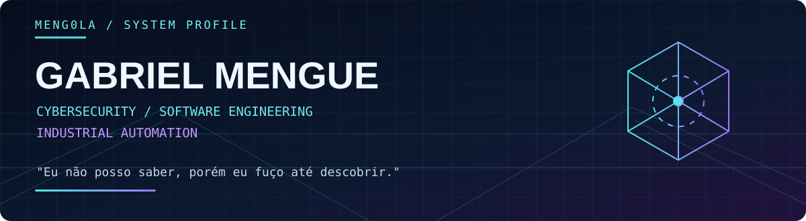
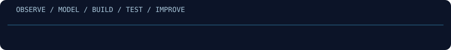

<div align="center">



**Cybersecurity · Secure Software · Automation · Industrial Systems**

[**PROJECTS**](https://github.com/Meng0la?tab=repositories) · [**3D PORTFOLIO**](https://meng0la.github.io/portfolio/) · [**LINKEDIN**](https://www.linkedin.com/in/gabriel-mengue-barros-b23447268/)

</div>

---

### `01 / WHOAMI`

```text
gabriel@meng0la:~$ whoami
Student of Cybersecurity. Builder of tools, systems and automations.

gabriel@meng0la:~$ cat mindset.txt
"Eu não posso saber, porém eu fuço até descobrir."
```

Sou estudante de **Segurança Cibernética** e construo software para resolver problemas reais. Minha experiência conecta **operações industriais, manutenção, aplicações web, automação e pesquisa de segurança**.

Gosto de investigar o que acontece por baixo da interface: protocolos, autenticação, bancos de dados, logs, regras de negócio e falhas. Construo ferramentas, testo hipóteses em laboratórios autorizados e documento o que aprendo.

*I study how systems fail so I can build more resilient systems.*

<details>
<summary><b>EN / About me</b></summary>

I'm a cybersecurity student and software builder working across secure applications, automation and industrial operations. I enjoy understanding systems from the inside out: networks, backend architecture, databases, observability and security boundaries. My projects range from authorized security research to tools solving operational problems.

</details>

---

### `02 / SELECTED BUILDS`

> Projetos reais. Problemas reais. Código, arquitetura, testes e aprendizado contínuo.

| Projeto | O que desenvolvi / explorei | Stack |
| :--- | :--- | :--- |
| **[CyberLab Dashboard](https://github.com/Meng0la/cyberlab-portfolio)** | Plataforma de treinamento e documentação de laboratórios de segurança, com mapeamento MITRE ATT&CK. | React · FastAPI · Supabase |
| **[ReconSpider](https://github.com/Meng0la/ReconSpider)** | Reconhecimento e mapeamento de superfícies de ataque para testes autorizados. | Python |
| **[ShieldCall](https://github.com/Meng0la/ShieldCall)** | Aplicativo Android para triagem e filtragem local de chamadas. | Kotlin · Jetpack Compose · Room |
| **[AeroCheck](https://github.com/Meng0la/cnc-checklist-system)** | Checklists CNC, histórico de conformidade, alertas e auditoria. | PHP · MySQL · Tailwind |
| **[Conferidor de MP](https://github.com/Meng0la/conferidor-mp)** | Conferência automatizada de materiais entre Excel e um portal web. | JavaScript · Bun · ExcelJS |
| **[Portfolio 3D](https://github.com/Meng0la/portfolio)** | Portfólio bilíngue com WebGL, cena tridimensional e interface responsiva. | React · Three.js · Framer Motion |
| **[GrimSweep](https://github.com/Meng0la/GrimSweep)** | Estudo experimental sobre artefatos Windows e sanitização em laboratório isolado. | Python · Windows |

#### Internal / private builds

**SIG Industrial** — gestão integrada de manutenção, qualidade, RH e TI, com autorização por papéis, dashboards e automações.

**empty / with / nothing** — jogo narrativo 2D em pixel art, construído com Godot 4 e GDScript.

Projetos privados são descritos apenas em alto nível. Código, credenciais e dados internos não são publicados.

---

### `03 / TECH STACK`

| Área | Tecnologias e práticas |
| :--- | :--- |
| **Languages** | Python · JavaScript · TypeScript · PHP · Kotlin · SQL · Bash |
| **Frontend** | React · Next.js · HTML/CSS · Tailwind · Three.js |
| **Backend & data** | FastAPI · Node.js · PostgreSQL · MySQL · Supabase |
| **Infrastructure** | Linux · Docker · Git · GitHub · Cloudflare |
| **Security** | AppSec · OSINT · Threat Modeling · Network Analysis · Authorized Pentesting |
| **Creative** | Godot · GDScript · Pixel Art Pipelines |

---

### `04 / ENGINEERING MINDSET`

<div align="center">

</div>

```text
[01] OBSERVE  -> Understand the real problem
[02] MODEL    -> Map dependencies and risks
[03] BUILD    -> Ship the smallest useful solution
[04] TEST     -> Validate behavior and failure modes
[05] IMPROVE  -> Measure, document and iterate
```

> Não me interessa apenas fazer funcionar. Quero entender **por que funciona**, **onde pode falhar** e **como manter seguro**.

Segurança ofensiva, para mim, é uma forma de compreender e melhorar a defesa. Testes são feitos apenas em ambientes próprios ou com autorização explícita.

---

### `05 / ACTIVITY & REPOSITORIES`

Sem gráficos externos que possam desaparecer: veja a atividade diretamente na fonte.

- **[Contribution graph / GitHub activity](https://github.com/Meng0la?tab=overview&from=2026-01-01&to=2026-12-31)**
- **[Public repositories](https://github.com/Meng0la?tab=repositories)**
- **[Security projects](https://github.com/Meng0la/cyberlab-portfolio)**
- **[Interactive portfolio source](https://meng0la.github.io/portfolio/)**

---

<div align="center">

**Security is not fear. It is comprehension.**

**[GitHub](https://github.com/Meng0la)** · **[LinkedIn](https://www.linkedin.com/in/gabriel-mengue-barros-b23447268/)**

</div>
